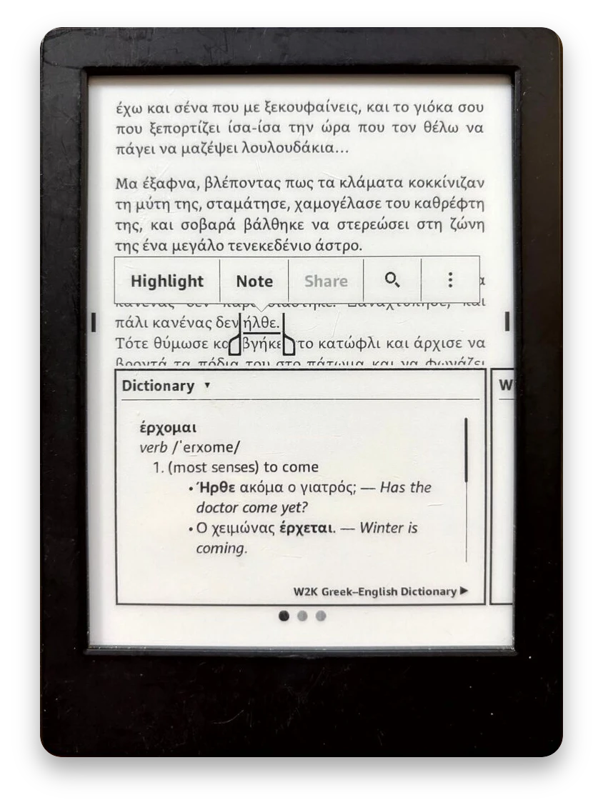
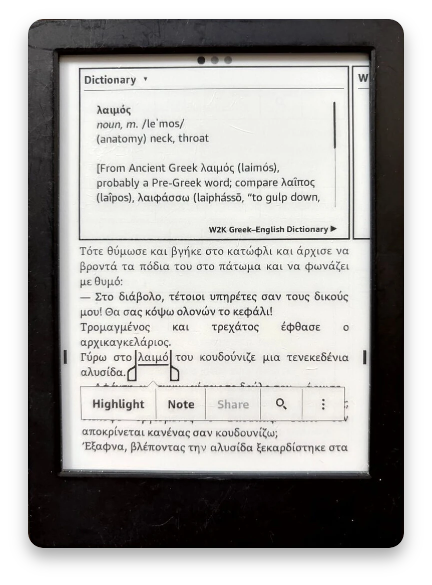
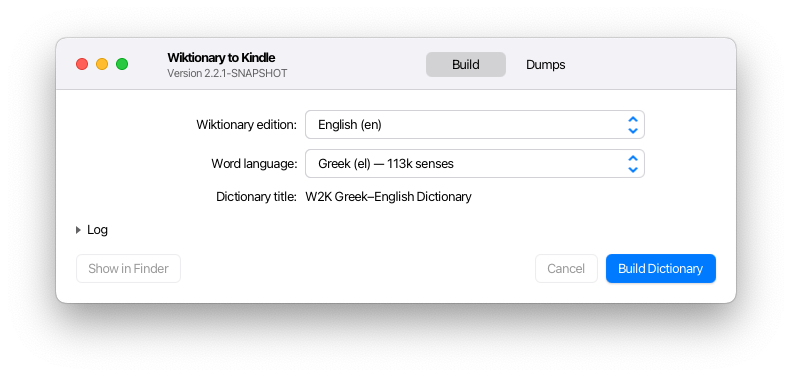
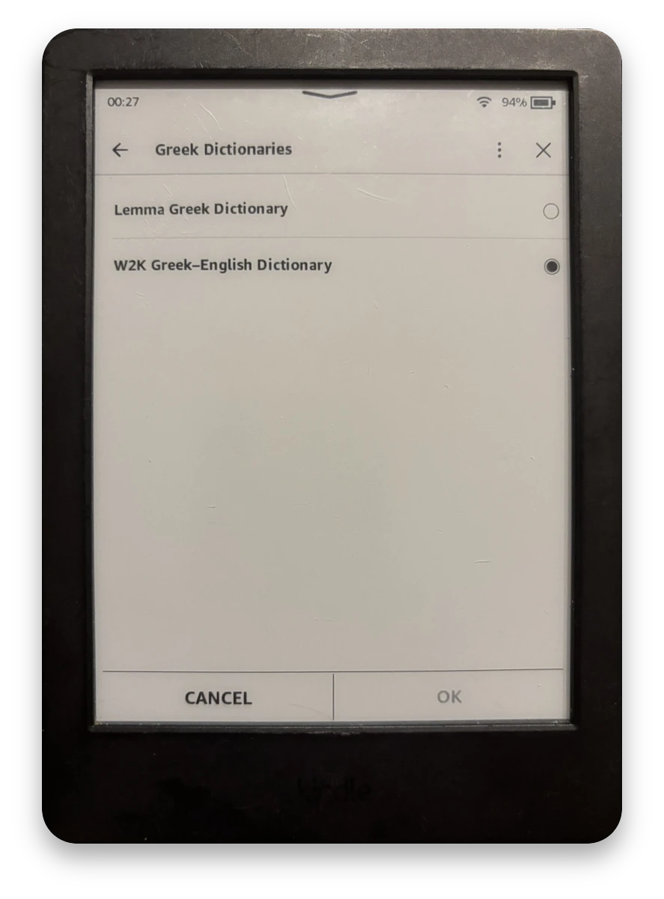

# wiktionary-to-kindle

Turns Wiktionary into a MOBI dictionary your Kindle can use for tap-to-define — in any of a hundred-odd languages, for any Wiktionary edition [kaikki.org](https://kaikki.org) publishes.

<p align="center">
  
  
</p>

Available as a desktop app that bundles its own Java runtime, or as a command-line tool.

<p align="center">
  
</p>

## Contents

- [Install](#install)
  - [macOS](#macos)
  - [Windows](#windows)
  - [Linux](#linux)
  - [Manual download](#manual-download)
- [Using the app](#using-the-app)
  - [On your Kindle](#on-your-kindle)
  - [Where files go](#where-files-go)
- [Command line](#command-line)
- [How it works](#how-it-works)
- [What an entry shows](#what-an-entry-shows)
- [Inflected forms](#inflected-forms)
- [Building from source](#building-from-source)

## Install

The desktop app is the recommended way to run this — it bundles its own Java runtime, so there is nothing else to install.

### macOS

```sh
brew install --cask nyg/tap/wiktionary-to-kindle
```

### Windows

```powershell
scoop bucket add nyg https://github.com/nyg/scoop-bucket
```

```powershell
scoop install wiktionary-to-kindle
```

Scoop installs per-user, needs no admin rights, and avoids the SmartScreen prompt.

Without Scoop, download `wiktionary-to-kindle-<version>-windows-x64.exe` from the [latest release](https://github.com/nyg/wiktionary-to-kindle/releases/latest) and double-click it. It also installs per-user and needs no admin rights, and it adds a Start Menu shortcut and a normal entry under Installed apps. Being unsigned, it does trip SmartScreen on first run — *"Windows protected your PC"*, then **More info** and **Run anyway**.

### Linux

```sh
sudo apt install ./wiktionary-to-kindle-<version>-linux-x64.deb
```

```sh
sudo dnf install ./wiktionary-to-kindle-<version>-linux-x64.rpm
```

Both install under `/opt/wiktionary-to-kindle` and register a desktop entry, so the app appears in your application menu. Remove it with `sudo apt remove wiktionary-to-kindle` or `sudo dnf remove wiktionary-to-kindle`.

On a distribution neither package suits, run the portable JAR instead, which needs Java 25 installed. See [Command line](#command-line).

### Manual download

Grab the [latest release](https://github.com/nyg/wiktionary-to-kindle/releases/latest):

| File | For |
|------|-----|
| `wiktionary-to-kindle-<version>-macos-arm64.dmg` | macOS (Apple Silicon) |
| `wiktionary-to-kindle-<version>-windows-x64.exe` | Windows — per-user installer, no admin rights |
| `wiktionary-to-kindle-<version>-windows-x64-scoop.zip` | Windows, no install — what Scoop consumes; extract it and run `Wiktionary to Kindle.exe` in place |
| `wiktionary-to-kindle-<version>-linux-x64.deb` | Debian, Ubuntu and derivatives |
| `wiktionary-to-kindle-<version>-linux-x64.rpm` | Fedora, RHEL, openSUSE and derivatives |
| `wiktionary-to-kindle-<version>.jar` | Any other distribution, or scripted use anywhere. Needs Java 25 |

The app is ad-hoc signed but **not notarized**, so macOS quarantines the DMG download and blocks the first launch — you may see *"is damaged"* or *"Apple could not verify…"*, which both mean the same thing and do not mean the app is corrupted. Homebrew handles this for you. If you installed the DMG by hand, clear the flag once:

```sh
xattr -dr com.apple.quarantine "/Applications/Wiktionary to Kindle.app"
```

## Using the app

1. Pick a **Wiktionary edition** — which Wiktionary the definitions are written in. The Greek Wiktionary defines words in Greek.
2. Pick a **word language** — which language's words to include. Any language may appear in any edition.
3. Press **Build Dictionary**.

So *edition: Greek, word language: English* gives you an English–Greek dictionary: look up an English word, read the definition in Greek. The title updates as you choose, so you can see what you are about to build.

The first build for an edition downloads its dump, which is 100 MB to several GB. Progress and a live log are shown throughout, and **Cancel** stops the run cleanly at any stage. Subsequent builds reuse the downloaded dump.

When it finishes, **Show in Finder** reveals the `.mobi` (*Open file location* on Windows, *Show in Files* on GNOME, *Open Containing Folder* on KDE) — `w2k-dictionary-en-el.mobi` for the example above. Copy it to your Kindle over USB: Send to Kindle, by email or app, stopped accepting `.mobi` files in 2023.

The **Dumps** page lists what has been downloaded, with the Wiktionary edition, generation date and size, and lets you delete dumps you no longer need — worth checking, since they are the largest thing this app puts on your disk.

### On your Kindle

Once the `.mobi` is on the device, set it as the default dictionary for its language, and tap-to-define uses it everywhere you read. Titles are prefixed `W2K`, so the dictionaries this app builds group together in that list and stay apart from Amazon's own.

<p align="center">
  
</p>

### Where files go

| What | Location |
|------|----------|
| Dumps and dictionaries | `~/Documents/wiktionary-to-kindle/` (change in Settings; the CLI uses the same folders) |
| Build leftovers | `dictionaries/intermediate/` — the HTML, OPF, NCX and cover files each build feeds to `kindling-cli`, one sub-folder per dictionary |
| Settings | `~/.config/wiktionary-to-kindle/` — `%LOCALAPPDATA%\wiktionary-to-kindle\Config` on Windows |
| Log file | `~/.local/state/wiktionary-to-kindle/logs/app.log`, rolled daily to `app-YYYY-MM-DD.log.gz` and kept 14 days — `%LOCALAPPDATA%\wiktionary-to-kindle\State` on Windows |
| Cached `kindling-cli` | `~/.cache/wiktionary-to-kindle/` — `%LOCALAPPDATA%\wiktionary-to-kindle\Cache` on Windows |

macOS included, these follow the [XDG Base Directory specification](https://specifications.freedesktop.org/basedir-spec/latest/) and honour `XDG_CONFIG_HOME`, `XDG_CACHE_HOME` and `XDG_STATE_HOME`. Dumps and dictionaries deliberately sit in your documents folder instead — they are multi-gigabyte and the `.mobi` has to be found and copied to a Kindle, so both belong somewhere a file manager shows by default. That folder is still resolved the XDG way, via `XDG_DOCUMENTS_DIR`.

Settings also lets you delete the build leftovers as soon as a dictionary is built, point at a pre-installed `kindling-cli`, or pin a specific version. Maximum heap is shown there but cannot be changed: it is fixed when the app starts, and the bundle sizes it at 75% of your machine's RAM.

## Command line

The same pipeline, for scripting and for Linux. Every release ships a portable JAR that runs anywhere with Java 25.

```sh
# Download a dump to the dumps folder (skipped if one for that edition already exists)
java -jar wiktionary-to-kindle-<version>.jar download el

# Generate into the dictionaries folder
# DUMP_LANG = which Wiktionary edition to read; WORD_LANG = ISO 639-1 filter
java -jar wiktionary-to-kindle-<version>.jar generate el en

# Read from and write to somewhere else, for one invocation
java -jar wiktionary-to-kindle-<version>.jar download el --dumps-dir ./dumps
java -jar wiktionary-to-kindle-<version>.jar generate el en --dumps-dir ./dumps --dictionaries-dir ./dictionaries

# Pin a kindling release, or use one already installed
java -jar wiktionary-to-kindle-<version>.jar generate el en --kindling-version vX.Y.Z
java -jar wiktionary-to-kindle-<version>.jar generate el en --kindling-cli /usr/local/bin/kindling-cli

java -jar wiktionary-to-kindle-<version>.jar --help
java -jar wiktionary-to-kindle-<version>.jar --version
```

`dl` and `gen` are short aliases. The CLI reads the same preferences file as the desktop app, so both front-ends share one dumps folder and one dictionaries folder: download in the app and generate from the command line, or the reverse, and the dump is found either way. `--dumps-dir` and `--dictionaries-dir` override that per invocation, for scripts that want their own working folders. `download` exits non-zero if the transfer fails.

Up to and including 2.0.3 the CLI resolved `dumps/` and `dictionaries/` relative to the working directory and ignored the app's preferences. To keep that behaviour, pass `--dumps-dir ./dumps --dictionaries-dir ./dictionaries`, or move the existing folders into `~/Documents/wiktionary-to-kindle/`.

## How it works

1. A [kaikki.org](https://kaikki.org) pre-extracted Wiktionary JSONL dump is downloaded for the chosen edition. Dumps are produced weekly by [wiktextract](https://github.com/tatuylonen/wiktextract) and include all languages with Lua templates fully expanded.
2. The compressed JSONL is streamed and filtered by language. Each entry is rendered into an HTML definition (see [What an entry shows](#what-an-entry-shows)), its inflected forms are collected as Kindle lookup targets, and the result is grouped in memory by normalised key.
3. Chunked MobiPocket HTML files, an NCX navigation map and an OPF manifest are written.
4. On first run, [kindling-cli](https://github.com/ciscoriordan/kindling) is downloaded and cached, verified against a pinned SHA-256.
5. `kindling-cli build` converts the OPF into a `.mobi` Kindle dictionary.

[`docs/program-flow.md`](docs/program-flow.md) has sequence diagrams for each stage.

## What an entry shows

Whatever the dump carries for a word, in this order:

* **Part of speech, gender and pronunciation** — `Nom commun, m. \a.kœj\`. The part of speech is in the edition's own words where kaikki provides them. The Greek and Russian dumps do not, so the app names it for them.
* **Senses**, numbered when there are several, with sub-senses nested under their parent. Register, region and domain labels lead each one in italics: *(figuratively)*, *(Québec)*.
* **Examples** — the three shortest of each sense, with the headword in bold, and the translation after a dash when Wiktionary gives one.
* **Etymology**, in square brackets.
* **Synonyms and antonyms**, after `≈` and `≠`, six of each at most.
* **Inflected forms**, described below.

The labels wiktextract recognises are stored in English whatever the edition, so a French definition can carry *(dated)*. The Greek edition keeps its labels in Greek.

## Inflected forms

Wiktionary entries on kaikki include a `forms` array listing every inflected form of the lemma — plurals, declension cases, conjugations, gender-agreement forms. `wiktionary-to-kindle` exposes those forms in two ways:

* **Lookup index** — every form becomes a tap-to-lookup target on Kindle via `<idx:iform>` markup. Looking up `συντρόφους` (the accusative plural) resolves to the lemma `σύντροφος`. Emitted for every part of speech, including verbs.
* **Visible paradigm table** — for non-verb entries, a small table of the form `{tag-abbrev}: {article} {form}` is appended to the definition. Verb entries skip the table (Greek, Romance and Slavic verbs have 50–200+ forms, which would dwarf the definition). A `forms.size() > 30` safety net also skips the table for pathological non-verb cases.

Gender-equivalent cross-references (e.g. `συντρόφισσα` listed as a feminine equivalent of `σύντροφος`, or `ingénieure` listed under `ingénieur`) are filtered out of the **lookup index** by a language-agnostic post-pass: any form whose normalised text already exists as a standalone headword in the same dump is dropped from the iform list, so long-press on `συντρόφισσα` resolves to its own entry instead of being shadowed by the lemma. The **visible "Forms:" table** in each entry's HTML body is untouched — readers still see the full paradigm (e.g. `ingénieure`, `ingénieurs`) under the lemma.

Where a verb's page names a separate passive lemma, as English Wiktionary does for Greek, the passive forms in its table look up that lemma: `σηκώθηκε` opens `σηκώνομαι` ("to get up"), not `σηκώνω` ("to lift"). Romanizations are listed in the table but are not lookup targets.

See [`docs/form-of-folding.md`](docs/form-of-folding.md) for the full design.

## Building from source

Requires Java 25 and [Apache Maven](https://maven.apache.org).

```sh
mvn package        # runs tests, produces target/wiktionary-to-kindle-<version>.jar
mvn javafx:run     # runs the desktop app
```

To build a native bundle for the host platform:

```sh
scripts/package.sh          # defaults per platform
scripts/package.sh deb rpm  # or name the types: dmg, app-image, exe, msi, deb, rpm
```

It jlinks a trimmed runtime, verifies it — TLS, locale data, the JavaFX modules and `ImageIO` all have to resolve inside the fresh image, and packaging fails if any of them do not — then runs `jpackage` once per type named. Output lands in `target/dist`. Packages can only be built for the platform you are on, and the Windows `exe` additionally needs the WiX Toolset on the `PATH`.

The release workflow ships the macOS `dmg`, the Windows `exe` and Scoop `app-image`, and the Linux `deb` and `rpm`. Per-PR CI only exercises the `dmg` and the `app-image`, so a regression in the other three surfaces when a release is cut rather than in review.

The shaded JAR deliberately excludes JavaFX so it stays cross-platform: JavaFX resolves to native, platform-specific artifacts, and the desktop app gets them from its bundled runtime instead.
